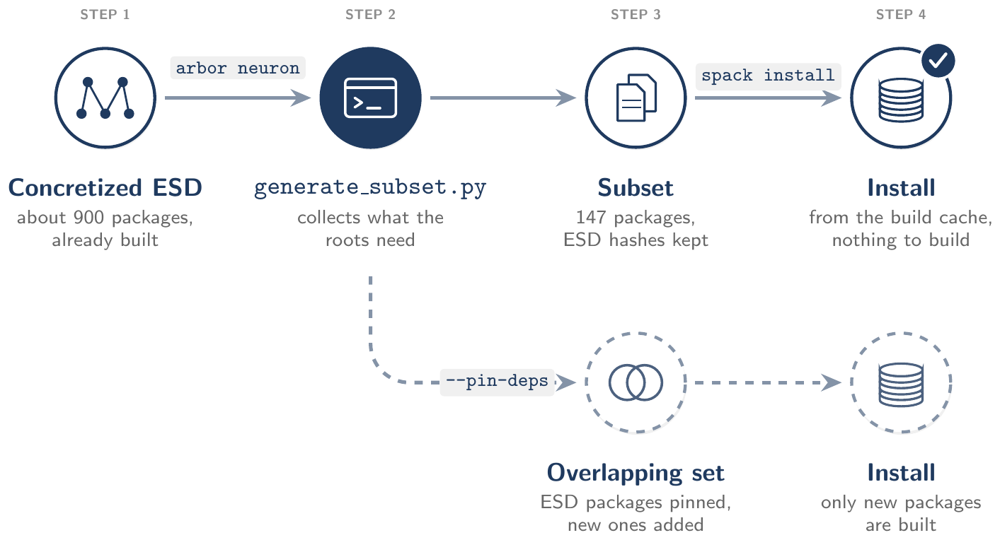
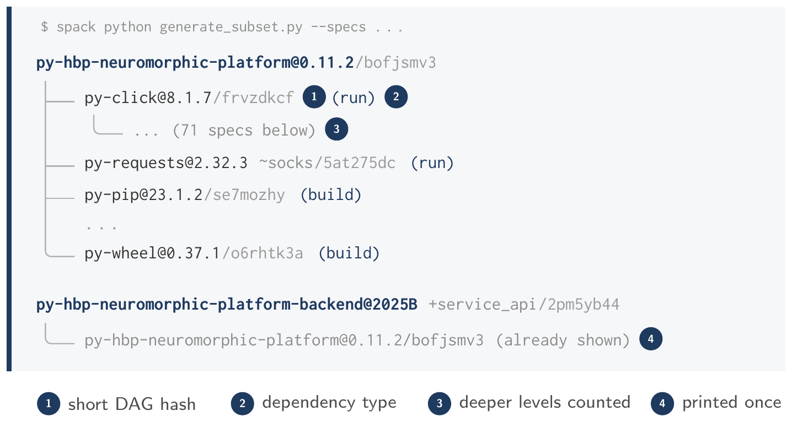
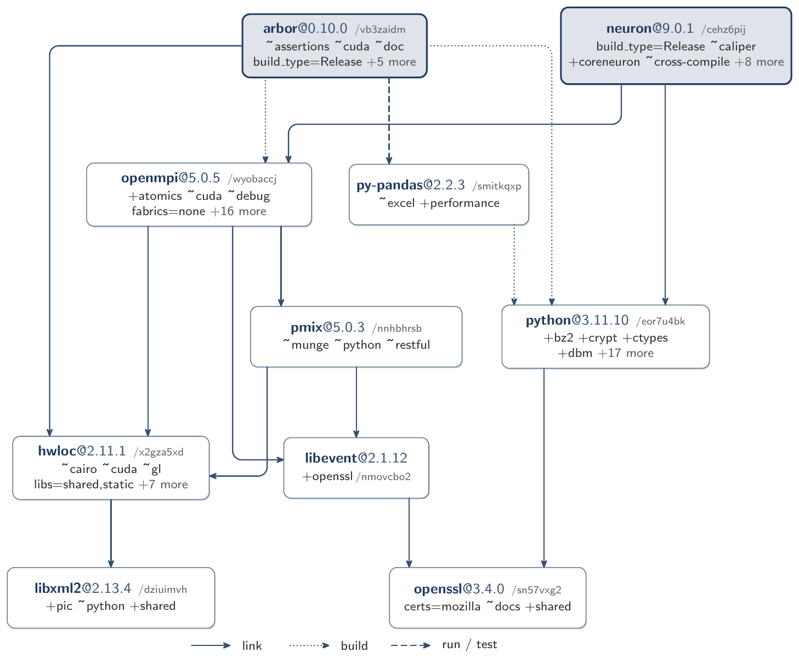
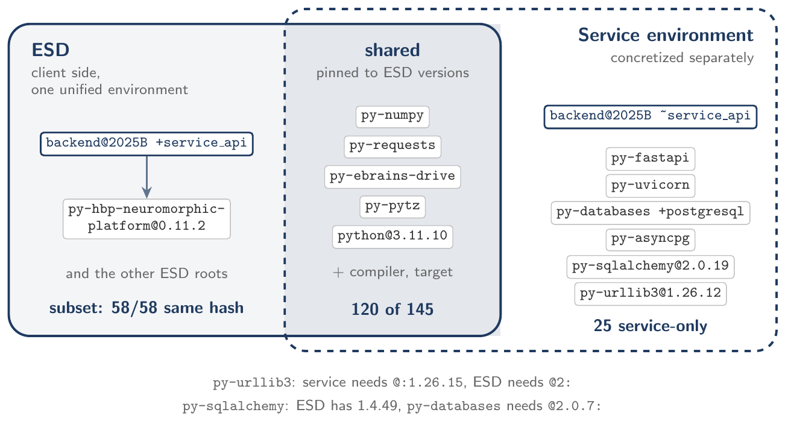
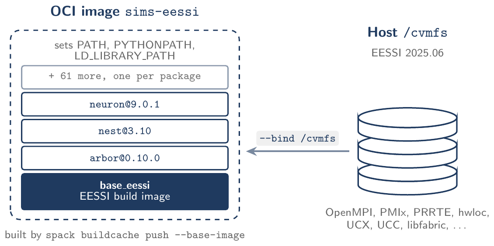

<div align="center">

# Google Summer of Code 2026:<br>EBRAINS Modular Software Environments<br>and Service Integration

</div>

## 1 Introduction

The EBRAINS Software Distribution (ESD)[^1] is a curated collection of tools for computational neuroscience, supporting education, research, and simulation across heterogeneous hardware, including HPC, GPUs, and neuromorphic computing systems.
These tools are readily deployed and used in scientific multi-site workflows [[1]](#references), including distributed and containerized pipelines on HPC infrastructures [[2, 3]](#references).
Many ESD tools are developed by the research community and leverage diverse hardware architectures for performance and scalability.
The ESD is built with the Spack package manager[^2] as one Spack environment with 86 root specs and 905 packages in total, and it is deployed as a "monolith".
The environment is concretized with `unify: true`, so every package appears in exactly one version and configuration.
This is what makes the ESD tools interoperable: they share the same Python, MPI and numerical libraries, so they can be loaded together, for example to drive NEST and Arbor from the same Python script.
This creates two major challenges:

**Flexibility:** Researchers might want to combine the ESD with other, possibly experimental, tools that are not yet in the official release.
Conversely, smaller minimum-size software ecosystems can be beneficial for other applications, such as for GDPR-sensitive environments.

**Service compatibility:** The ESD contains "client" software that interacts with EBRAINS "web" services.
The service-side environment must be strictly compatible with the client-side version, which can't be guaranteed unless services are also part of the ESD.

This project adds modularity to the ESD's Spack-based build and deployment.
We developed tooling that generates custom environments from an ESD release, both subsets and overlapping sets with new packages, that keep the hashes of the release and therefore its binaries and its interoperability ([Section 3](#3-subset-environments)).
We also extended the ESD to describe services.
Services often depend on a smaller or different set of packages than the end-user tools, so we track the service-side dependencies explicitly in Spack and express the compatibility between client and service versions as package constraints ([Section 4](#4-services-in-the-esd)).
Finally, we built the ESD simulators on top of EESSI and packaged them as a runtime container (Sections [2](#2-eessi-and-spack) and [5](#5-building-on-eessi)).
All results were produced in CI ([Section 7](#7-testing-in-ci)).

## 2 EESSI and Spack

The European Environment for Scientific Software Installations (EESSI)[^3] provides a shared stack of optimised scientific software for many CPU architectures.
It is distributed through CernVM-FS (CVMFS)[^4], a read-only file system that fetches files over HTTP on first access and caches them locally, so the same versioned installation is available under `/cvmfs/software.eessi.io` on every system that mounts it.
EESSI consists of a compatibility layer, which provides base libraries independent of the host operating system, and a software layer with one build per CPU microarchitecture.
The software layer is built with EasyBuild and is used through environment modules.

In this project we investigated whether ESD top-level packages, namely Arbor, NEST and NEURON, can be built with Spack while reusing the MPI stack and its dependencies from EESSI instead of building them again.

## 3 Subset Environments

The ESD is a single, unified Spack environment of about 900 packages, while most use cases need only a small part of it.
Out of its 905 packages, 815 are needed to link or run the 86 roots, and the other 90 are only needed to build or test them.
A smaller environment can be written by hand, but concretizing it independently gives Spack the freedom to select different versions or variants for shared dependencies.
The resulting DAG hashes then differ from the ESD, and the existing ESD binaries can no longer be reused.

Our approach avoids a new concretization altogether: the smaller environment, which we call a *subset*, is extracted directly from the concretized ESD.
Figure 1 gives an overview of the workflow, and Figures 2 and 3 in [Section 3.4](#34-printing-the-subset) show an extracted subset as a tree and as a graph.

<p align="center"></p>

Figure 1: Workflow of the subset generator. The script collects the dependency closure of the requested roots from the concretized ESD and copies it with unchanged hashes, so the subset is installed from the ESD build cache without building anything. When packages outside the ESD are added (dashed path), shared dependencies are pinned to their ESD builds and only the new packages are built.

### 3.1 Subset generator

We implemented the extraction in `generate_subset.py`, a script that runs under `spack python`.
It takes the concretized ESD environment, a list of root packages (e.g. `arbor neuron`) and an output directory.
The script locates the requested roots among the top-level specs of the ESD and traverses their dependency graph over all dependency types (build, link, run and test).
The resulting dependency closure is written out as a new Spack environment:

- `spack.yaml` contains only the requested roots, with the same abstract specs as in the ESD manifest, so variants such as `+python +mpi` are preserved. The ESD site configuration, which sets the target, compiler and version preferences, is copied alongside.
- `spack.lock` is the part of the ESD lock file that covers the dependency closure, copied without modification.

Since the lock file is not recomputed, every package in the subset keeps its ESD hash and is installed directly from the ESD build cache.
For `arbor neuron`, the resulting subset contains 2 roots and 147 specs.
The script can additionally render the dependency graph of the subset with Graphviz.

### 3.2 Overlapping sets

Once a package that is not part of the ESD is added, for instance a user's own model, the environment has to be concretized again.
With fewer roots than the ESD, the concretizer is less constrained and may change shared dependencies, which in turn changes the hashes of every package built on top of them.
We refer to such a combination of new packages and ESD packages as an *overlapping set* (dashed path in Fig. 1).

To keep the shared part identical to the ESD, we added options that pin dependencies to their concrete ESD builds:

- `--pin-deps` adds the link and run dependencies of each root as `^/<hash>` constraints, one per dependency, for example<br>`arbor@0.10.0 +python +mpi ^/<hash of openmpi>`<br>Spack resolves these hashes from the environment, the local store or the build cache and reuses the existing builds.
- `--pin-deps-only` restricts pinning to a given list of packages, e.g. MPI and Python, and leaves the rest of the closure to the concretizer.
- `--non-esd-root` handles roots that are not in the ESD at all by constraining shared dependencies to their ESD *versions* (`^name@version`) rather than hashes.

The generator still writes the ESD lock file next to the pinned `spack.yaml`.
Once new packages are added, however, Spack concretizes the environment again, and it is the pins, not the lock file, that keep the ESD builds.
Build-only dependencies are not pinned, because the ESD contains more than one version of some of them (e.g. `py-setuptools` 62.6.0 and 69.2.0) and a unified environment cannot hold both.

### 3.3 Validation

We added a CI check that generates several subsets and re-concretizes each of them from its `spack.yaml` alone, ignoring the generated lock file.
It then counts how many specs in the link and run closure of the roots still match their ESD hash (Table 1).
This is stricter than actual use, where the generated lock file already contains the ESD builds.
A failed concretization is reported explicitly rather than as a number, so it cannot be mistaken for full reuse.

Table 1: Packages that keep their ESD hash when a subset is concretized again (packages needed to link or run). CI pipeline #82931.

<table border="1" cellpadding="8" style="border-collapse: collapse">
<thead>
<tr><th align="left" width="290">Subset</th><th align="center" style="text-align: center" width="180">Same hash / total</th><th align="center" style="text-align: center" width="110">Reuse</th></tr>
</thead>
<tbody>
<tr><td><code>neuron</code></td><td align="center">58/58</td><td align="center">100 %</td></tr>
<tr><td><code>nest</code></td><td align="center">86/86</td><td align="center">100 %</td></tr>
<tr><td><code>arbor</code></td><td align="center">68/70</td><td align="center">97 %</td></tr>
<tr><td><code>arbor</code> + <code>neuron</code></td><td align="center">69/71</td><td align="center">97 %</td></tr>
<tr><td><code>arbor</code> + <code>neuron</code>, <code>--pin-deps</code></td><td align="center">70/71</td><td align="center">99 %</td></tr>
</tbody>
</table>

NEURON and NEST are reproduced exactly.
For arbor, and for the combined subset with both arbor and NEURON as roots, two specs differ: `py-mpi4py`, a run dependency that the concretizer resolves differently with fewer roots, and arbor itself.
With `--pin-deps`, `py-mpi4py` matches again and only the arbor root remains different.
This is because the ESD is concretized with `--test root`, so the ESD build of arbor includes its test dependencies (e.g. `py-pandas`, `py-seaborn`), whereas the check concretizes the subset without them.
The difference affects only this check; the generated lock file contains the ESD build of arbor.
Running the check with `--test root` as well, like the ESD, would remove this difference; we have not done that yet.

In summary, subsets of ESD packages are installed entirely from the ESD build cache, and overlapping sets rebuild only the packages that are new.

### 3.4 Printing the subset

After writing the subset, the script prints it as a tree (Fig. 2).
Each line shows a package, its main variants and the start of its hash, so it is easy to compare with the ESD.
A tag shows how the package is needed (build, run or test; no tag means link).
A package that appears twice is printed only once and then marked `already shown`, and deeper levels are just counted.

<p align="center"></p>

Figure 2: Tree printed by `generate_subset.py` for the client subset of [Section 4](#4-services-in-the-esd) (CI [job 218329](https://gitlab.ebrains.eu/divyanshu15/ebrains-spack-builds/-/jobs/218329)); some dependencies of the first root are left out.

With `--dot`, the script also draws the same graph with Graphviz (Fig. 3).
Roots have a thick border, and each arrow shows how one package needs another.

<p align="center"></p>

Figure 3: Ten packages of the `arbor neuron` subset in the Graphviz output of `--dot` (CI [job 218329](https://gitlab.ebrains.eu/divyanshu15/ebrains-spack-builds/-/jobs/218329)). Boxes carry the same labels as the generated file (package, first variants, short DAG hash), roots are shaded, and the layout is the one Graphviz computes. The full subset has 147 packages.

## 4 Services in the ESD

EBRAINS services offer an API, and client packages in the ESD talk to it.
Client and service must agree on the protocol version.
But the service usually needs other dependencies than the client, and some of them clash with the ESD.

As a test case we used the backend of the EBRAINS neuromorphic platform ([MR !742](https://gitlab.ebrains.eu/ri/tech-hub/platform/esd/ebrains-spack-builds/-/merge_requests/742)).
Its Spack package has a `service_api` variant that splits the two roles:

- With `+service_api`, the package only depends on the matching client, which is already in the ESD.
- With `~service_api`, it describes the full service stack (FastAPI, Uvicorn, SQLAlchemy and more).

The two roles cannot share one unified environment, because some of their dependencies need versions that exclude each other.
For example, the service needs an older `py-urllib3` than the ESD allows.
So we generate two environments (Fig. 4).

**Client side.**
The client is an ESD root, so the generator extracts it like any other subset.
All its link and run packages keep their ESD hash.

**Service side.**
The service is not in the ESD.
The generator writes a new environment for it with `--non-esd-root` and pins the shared packages, such as NumPy and Requests, to their ESD versions.
SQLAlchemy is left free, because the service needs a newer version than the ESD has.
In the result, 120 of the 145 packages are the same builds as in the ESD, and the other 25 are only needed by the service.

Both environments are generated and checked in CI ([pipeline #82946](https://gitlab.ebrains.eu/divyanshu15/ebrains-spack-builds/-/pipelines/82946)).
For now the service package does not install the real service; it is only used to test concretization.

<p align="center"></p>

Figure 4: Client and service environments for the neuromorphic platform backend. The client side is part of the ESD and keeps every ESD hash. The service is concretized on its own, with the shared packages pinned to their ESD versions. The two conflicts at the bottom are why both cannot live in one environment.

## 5 Building on EESSI

### 5.1 External package definitions

An *external* tells Spack that a package is already installed and must not be built.
For each EESSI package we give both its install path (`prefix`) and its environment module, and we list which other externals it depends on (Listing 1).
With only one of the two the build failed; with both, NEST built and linked against the EESSI MPI in CI ([job 213855](https://gitlab.ebrains.eu/divyanshu15/ebrains-spack-builds/-/jobs/213855)).

Listing 1: Generated external definition for OpenMPI (shortened).

> ```yaml
> openmpi:
>   buildable: false
>   externals:
>   - spec: openmpi@5.0.8
>     prefix: /cvmfs/software.eessi.io/versions/2025.06/software/linux/x86_64/
>       ↪ amd/zen2/software/OpenMPI/5.0.8-GCC-14.3.0
>     modules: [OpenMPI/5.0.8-GCC-14.3.0]
>     id: openmpi_eessi
>     dependencies:
>     - id: hwloc_eessi
>       deptypes: link
>     ...
> ```

The definitions are generated by a script, `eessi_externals.py`, from the EESSI software metadata.
It starts from a module, such as OpenMPI, follows its runtime dependencies and skips build-only ones.
The metadata only lists paths for one CPU type, so the script replaces the CPU part of each path with that of the target system.
Packages from the EESSI compatibility layer, such as zlib, are not in the metadata and are added separately.

### 5.2 Results with Spack 1.2

With Spack 1.2 and EESSI 2025.06, we installed Arbor, NEST and NEURON with MPI and Python support ([job 215999](https://gitlab.ebrains.eu/divyanshu15/ebrains-spack-builds/-/jobs/215999)).
The whole MPI stack, including OpenMPI, PMIx, hwloc and UCX, came from EESSI and was not rebuilt.
The job also checks with `ldd` that every library is found and that each MPI library is loaded from only one place, as OpenMPI 5 requires.

Getting there needed three kinds of changes:

- **Recipes.** The ESD recipes were written before Spack 1.x and do not declare the compiler as a dependency, which Spack 1.x requires. We added it.
- **Version limits.** Spack 1.2 picks newer versions than the ESD, and a few of them break the build. We kept pybind11 and Cython at older versions and built OpenSSH without Kerberos.
- **Build environment.** The GCC module must stay loaded during the build. Otherwise, tools built during the NEURON build pick up an older C++ library.

**A missing dependency.**
The `ldd` check showed that Arbor uses hwloc, but the hwloc path was missing from its RPATH.
Arbor's build uses hwloc whenever it finds it, but the recipe does not declare it, so Spack does not add its path.
We added the dependency to the recipe, and Arbor now uses the same EESSI hwloc as OpenMPI.

### 5.3 Runtime container

We also publish the installed simulators as a container image, without writing a Dockerfile (Fig. 5).
Spack's `buildcache push --base-image` puts each installed package in its own layer on top of the EESSI build image.
EESSI itself is not copied into the image; it comes from `/cvmfs` on the host.
A second CI job starts the image, imports the three simulators and runs a small NEST simulation on two MPI ranks ([pipeline #85823](https://gitlab.ebrains.eu/divyanshu15/ebrains-spack-builds/-/pipelines/85823)).
We also build an image for AMD Zen 2, the CPU of JUSUF.
The image has also been started on an HPC login node, where it worked; runs on compute nodes are still open.

<p align="center"></p>

Figure 5: Runtime container. Each Spack package is a separate image layer on top of the EESSI build image, while the EESSI software, including the MPI stack the simulators link against, comes from the host's CVMFS mount at runtime.

## 6 MPI Benchmarks

To check that programs built by Spack against the EESSI OpenMPI run correctly, we built the OSU Micro-Benchmarks 7.4 and ran them in CI (Table 2): once with Spack 0.23 and the OpenMPI 5.0.3 module ([job 215134](https://gitlab.ebrains.eu/divyanshu15/ebrains-spack-builds/-/jobs/215134)), and once with Spack 1.1 and OpenMPI 5.0.8 given by prefix ([job 215135](https://gitlab.ebrains.eu/divyanshu15/ebrains-spack-builds/-/jobs/215135)).
Both runs used one machine, so the ranks communicated through shared memory, and the values are in the expected range for that case.
Each value is from a single run on a shared runner, so small differences are noise, and runs with more ranks did not start because `/dev/shm` on the runner is too small.
The results show that the EESSI MPI stack works with Spack-built programs; the network between nodes still has to be measured on compute nodes, e.g. on JUSUF.

Table 2: OSU Micro-Benchmarks 7.4 with two MPI ranks on one CI machine (AMD Zen 2). Each value is from a single run. In the second job, `mpirun` came from the 5.0.3 module.

<table border="1" cellpadding="8" style="border-collapse: collapse">
<thead>
<tr><th align="left" width="170">Test</th><th align="center" style="text-align: center" width="140">Message size</th><th align="center" style="text-align: center" width="135">Spack 0.23<br><sub>OpenMPI 5.0.3</sub></th><th align="center" style="text-align: center" width="135">Spack 1.1<br><sub>OpenMPI 5.0.8</sub></th></tr>
</thead>
<tbody>
<tr><td rowspan="2">Latency (µs)</td><td align="center">1 B</td><td align="center">0.68</td><td align="center">0.73</td></tr>
<tr><td align="center">1 MiB</td><td align="center">104</td><td align="center">99</td></tr>
<tr><td>Bandwidth (GB/s)</td><td align="center">4 MiB</td><td align="center">16.6</td><td align="center">17.6</td></tr>
<tr><td>Allreduce (µs)</td><td align="center">1 MiB</td><td align="center">540</td><td align="center">622</td></tr>
<tr><td>MPI startup (ms)</td><td align="center">–</td><td align="center">207</td><td align="center">241</td></tr>
</tbody>
</table>

## 7 Testing in CI

Apart from the first run on an HPC login node, every result in this report comes from a CI job in our fork of the ESD repository, so it can be rerun and its logs checked.
The subset checks run on every push.
The EESSI and container jobs build from source and need the EESSI mount, so they are started by hand and do not block the ESD pipeline.
All changes are collected in [MR !802](https://gitlab.ebrains.eu/ri/tech-hub/platform/esd/ebrains-spack-builds/-/merge_requests/802); the subset generator part was split into [MR !824](https://gitlab.ebrains.eu/ri/tech-hub/platform/esd/ebrains-spack-builds/-/merge_requests/824) for review.


## Acknowledgements

This project would not have been possible without the people who supported it, and I am grateful to all of them.

First, I would like to thank my mentors.
Dr. Eric Müller proposed the project and guided it from the first week to the last.
He wrote the first service package for the neuromorphic platform backend, set up the EESSI build image and the registry used for the runtime container, and turned the subset generator into a merge request for the ESD.
His questions and reviews often pointed me to the part of a problem that really mattered.

Eleni Mathioulaki helped me get started with the ESD and its CI and built the small test repository I used before working on the real ESD.
Her careful reviews found real problems in the generator and made the code much better.

Dr. Krishna Kant Singh shared his experience with HPC containers and EESSI, which shaped the container part of this project.
He set up this report, reviewed it in detail, and tested the runtime image on an HPC system.

I also thank Dr. Ekaterina Zossimova for organising the EBRAINS participation in Google Summer of Code, the EBRAINS team for the CI runners, build cache and container registry, and Google Summer of Code for making this project possible.
Working with this team has taught me a great deal about building, testing and sharing scientific software.

## References

[1] K. Nölp and L. Oden. *Simplifying distributed workflows: A portable approach for Cloud and HPC*. Sept. 2025. doi: [10.5281/zenodo.18337478](https://doi.org/10.5281/zenodo.18337478).

[2] K. K. Singh, E. Müller, E. Mathioulaki, W. Klijn, and L. Oden. *HPC Containers for EBRAINS: Towards Portable Cross-Domain Software Environment*. 2026. arXiv: [2603.12044](https://arxiv.org/abs/2603.12044) \[cs.DC\].

[3] K. K. Singh, C. Linssen, E. Müller, E. Mathioulaki, W. Klijn, and L. Oden. *Unifying von-Neumann HPC and Neuromorphic Acceleration via the EBRAINS Research Infrastructure: A Framework for High-Performance Workflows*. 2026. arXiv: [2606.08515](https://arxiv.org/abs/2606.08515) \[cs.DC\].

[^1]: <https://ebrains.eu/esd>
[^2]: <https://spack.readthedocs.io>
[^3]: <https://www.eessi.io/>
[^4]: <http://cernvm.cern.ch/>
